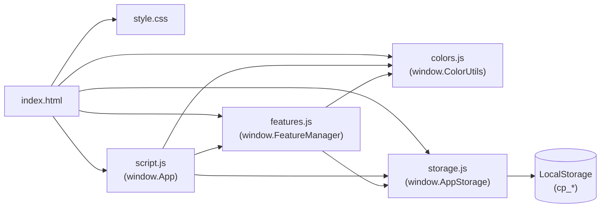

# ColorPalette — Explore • Choose • Create

> *Infinite colors. Limitless creativity.*

A lightning-fast, zero-dependency, client-side web application and design exploration toolkit encompassing the complete 24-bit RGB color spectrum: **16,777,216 distinct colors**.

📖 **[Read the Full Technical Manual & Architecture Documentation (DOCUMENTATION.md)](DOCUMENTATION.md)**

---

## 🎨 Overview

**ColorPalette** delivers a high-performance color workstation directly in your web browser. Built entirely with vanilla web standards (HTML5, modern CSS3, and ES6+ JavaScript), it eliminates all complex build toolchains, bundlers, and npm dependencies. Whether you are a web designer picking accessible UI colors, a front-end developer looking up color space conversions, or an accessibility engineer checking WCAG contrast compliance, ColorPalette provides a unified, responsive toolkit.

---

## ✨ Features

### 🌟 Core Library & Browsing
- **Complete RGB Color Space**: Mathematically indexes all 16,777,216 colors (256 × 256 × 256 combinations) with instant O(1) virtual pagination across 65,536 pages.
- **15 Color Categories**: Intuitive sidebar navigation covering All Colors, Red, Orange, Yellow, Green, Cyan, Blue, Purple, Pink, Brown, Gray, Black & White, Favorites, Custom Palettes, and Color Picker.
- **Precision Color Search**: Debounced 300ms multi-format search supporting HEX (`#3366FF`, `#FFF`), RGB syntax (`rgb(255, 0, 0)`), and all 148 standard CSS named colors (e.g., `coral`, `rebeccapurple`).
- **4 Color Sort Modes**:
  - **Popular** (Default): HSL vibrancy-first traversal displaying vivid colors first.
  - **Hue**: Order by HSL hue angle (0° to 360°).
  - **Brightness**: Order by perceived photometric luminance (`0.299R + 0.587G + 0.114B`).
  - **Value**: Direct linear RGB memory order.
- **Selected Color Detail Panel**:
  - Real-time swatch preview with CSS named color tags.
  - Simultaneous readout for **HEX**, **RGB**, **HSL**, and **HSV** formats.
  - One-click individual format copying and "Copy All" bundle action.
  - 8 harmonic similar-color suggestions with instant navigation.
  - Quick-save to Favorites and Palette assignment.
- **Grid & List Views**: Configurable layout density and adjustable page sizes (64, 128, 256, 500 items).
- **Collapsible Technical Panel**: 5-section interactive technical reference documenting color science, virtual pagination mechanics, card anatomy, and spectrum distribution.

---

### ⚡ 6 Integrated Extra Tool Modules

| # | Tool | Identifier | Capabilities |
|---|---|---|---|
| **1** | **Random Color Generator** | `randomColor` | Generates true random colors across the 24-bit space with instant multi-format readout, quick-copy, and favorites saving. |
| **2** | **Color Converter** | `converter` | Real-time bidirectional converter syncing between HEX, RGB, HSL, and HSV with error validation and copy buttons. |
| **3** | **Gradient Generator** | `gradient` | Multi-stop linear and radial gradient builder with custom angles, draggable stops, live visual preview, and CSS code generator. |
| **4** | **Saved Palettes Manager** | `palettes` | Full palette collection organizer: create palettes, add/remove color swatches, rename groups, copy HEX arrays, and delete sets. |
| **5** | **WCAG Contrast Checker** | `contrast` | Computes exact WCAG 2.1 contrast ratios (1:1 to 21:1), testing compliance badges for AA Normal, AA Large, AAA Normal, and AAA Large with live sample text. |
| **6** | **Export & Download** | `export` | Exports custom palettes or favorites directly to disk as CSS Variables (`.css`), JSON Array (`.json`), Plain Text (`.txt`), or Canvas-rendered PNG swatches (`.png`). |

---

### ⚙️ Feature Registry & Toggle System
- Accessible from the **Features ⚡** header button.
- Toggle switches enable or disable any of the 6 extra modules instantly without page reloading.
- Feature enabled states automatically persist in `localStorage`.
- Disabled features hide shortcut launch buttons and prevent accidental execution.
- "Restore Defaults" option resets all features to enabled.

---

### 🌗 Theming & Responsive Layout
- **Dark Navy Premium Theme** (Default): High-contrast dark palette designed for vibrant color visibility.
- **Light Theme**: Clean, minimalist daylight appearance.
- **100% Responsive**:
  - **Desktop (≥ 1200px)**: 3-column layout (Sidebar, Main Content Grid, Selected Color Panel).
  - **Tablet (768px – 1199px)**: 2-column layout with collapsible sidebar.
  - **Mobile (< 768px)**: Single-column view with touch drawer sidebar and bottom sheet for feature access.

---

## 🚀 Quick Start / Setup

No installation, build step, or bundler is required.

1. Clone or download the project files into a folder.
2. Open `index.html` in any modern web browser:
   - Double-click `index.html` directly (works over `file://`), or
   - Serve using any static server (e.g. `npx serve`, Python `python -m http.server`, or VS Code Live Server).

```bash
# Optional local static server example:
python -m http.server 8000
# Open http://localhost:8000 in your browser
```

---

## 🏗️ Architecture Overview

The application follows a modular, decoupled architecture using the **Immediately Invoked Function Expression (IIFE)** pattern. This isolates scope, avoids global pollution, and allows flawless execution over local `file://` protocols without ES module CORS restrictions.



### Script Loading Order (in `index.html`)

1. **`colors.js`** (`window.ColorUtils`):
   Pure color mathematical engine — zero DOM access, zero storage access. Handles RGB/HEX/HSL/HSV conversions, relative luminance, WCAG contrast calculation, sorting algorithms, and on-demand color space generation.
2. **`storage.js`** (`window.AppStorage`):
   Persistence layer wrapping `localStorage` with fail-safe error handling. Manages favorites (`cp_favorites`), custom palettes (`cp_palettes`), settings (`cp_settings`), and feature toggle states (`cp_features`).
3. **`features.js`** (`window.FeatureManager`):
   Feature registry, toggle control, modal focus management, and the 6 extra feature modules. Calls `ColorUtils` and `AppStorage`.
4. **`script.js`** (`window.App`):
   Main controller. Initializes DOM state, handles event delegation, manages virtual pagination and debounced search, updates the selected color panel, and coordinates responsive drawers.

---

## 📁 File Descriptions

| File | Description |
|---|---|
| `index.html` | Semantic HTML5 application shell defining navigation, layout columns, bottom panel, modal containers, and accessibility markup. |
| `style.css` | Complete custom CSS3 design system including dark/light theme CSS variables, typography, flexbox/grid layout, animations, and responsive media queries. |
| `colors.js` | Pure mathematical color engine implementing all color conversions, WCAG analysis, category bounds, and virtual page generators. |
| `storage.js` | Robust LocalStorage abstraction managing favorites, palettes, UI preferences, and feature states with JSON validation. |
| `features.js` | Feature registry and complete interactive implementations for the 6 extra tool modules with accessible modal management. |
| `script.js` | Primary application orchestrator handling virtual pagination, selection state, debounced search, theme switching, and event wiring. |
| `README.md` | Comprehensive project documentation, architectural overview, and usage instructions. |

---

## 📖 Usage Guide

### Browsing Colors
1. Select any category from the left sidebar (e.g. **Blue**, **Green**, or **Favorites**).
2. Use the pagination bar at the top or bottom to page through the 65,536 virtual pages.
3. Click any color card to inspect its details in the right-hand panel.

### Searching
- Type in the toolbar or header search bar. Search is debounced by 300ms.
- Search by HEX (e.g. `#6366F1`), RGB channel values, or CSS color names (e.g. `crimson`, `teal`).
- Click **Reset** in the toolbar to clear all search and sort filters.

### Using Extra Features
- Click **Features ⚡** in the top navigation to view the toggle registry.
- Click any feature shortcut button or launch directly from the Features panel.
- Press <kbd>Escape</kbd> at any time to close active modals, mobile sheets, or menus.

### Exporting Palettes
1. Open the **Export / Download** tool (`📥`).
2. Select your color source (Current Favorites, a Saved Palette, or the Selected Color).
3. Select your format (CSS Variables, JSON Array, Plain Text, or PNG Swatch Image).
4. Click **Download File** to save directly to your computer.

---

## 🌐 Browser Support

Compatible with all modern Evergreen web browsers:
- Google Chrome / Chromium (version 80+)
- Mozilla Firefox (version 75+)
- Apple Safari (version 13.1+)
- Microsoft Edge (version 80+)

---

## ⚠️ Known Limitations
- **Named Colors**: Only the 148 official W3C CSS named colors have human-readable names; arbitrary RGB colors use nearest-neighbor Delta-E matching.
- **LocalStorage Quota**: Browser LocalStorage typically has a 5MB to 10MB limit per origin. Only lightweight metadata (palette names and HEX strings) is stored, ensuring hundreds of palettes can be saved without approaching storage quotas.

---

## 📜 Credits & License

Built with ❤️ using vanilla web technologies.
*ColorPalette — Infinite colors. Limitless creativity.*
